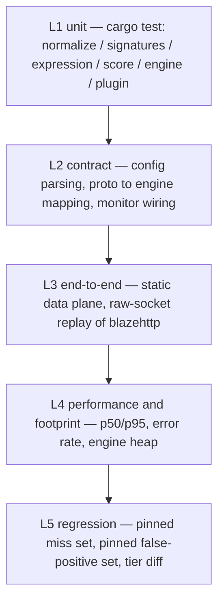

# PingWAF WAF Engine Test Plan

- Version under test: `0.32.4` (`[workspace.package]` in `Cargo.toml`)
- Scope: `pingwaf-waf` detection engine, `pingap-plugin` WAF integration and the
  static data-plane path that executes them
- Dataset: [chaitin/blazehttp](https://github.com/chaitin/blazehttp) —
  33 877 raw HTTP samples (658 malicious / 33 219 benign)
- Companion documents: [waf-test-report.md](./waf-test-report.md) (measured
  results of this round), [waf-benchmark-report.md](./waf-benchmark-report.md)
  (per-round data appendix, P0 → P14), [waf-engine-review.md](./waf-engine-review.md)
  (engine review and design rationale)

This plan replaces the ad-hoc "run the replay script and read the summary"
practice with a layered, repeatable suite. Every number in the companion report
comes from a command defined here.

## 1. What changed since the previous baseline

The previous published baseline (`0.20.0`, benchmark report §21) no longer
describes the engine. The behaviours below are the reason this plan exists; each
one carries its own test obligation.

| Change | Behaviour | Test obligation |
|---|---|---|
| Managed rule set | 15 rules defined; Normal assembles 13, `PINGWAF-1061` and `PINGWAF-1070` are Strict-only (`pingwaf-waf/src/rules/managed.rs`) | Assert both normal and strict assembly counts; a Strict-only rule must never fire on the Normal tier |
| Request-body decompression | `gzip` / `x-gzip` / `deflate` decoded, capped at 1 MiB (`MAX_DECOMPRESSED_BODY`); `br` and `zstd` are **not** decoded and are reported as uninspected (`normalize/body.rs`) | Compressed payload must be detected; oversize body must be truncated and marked, not silently passed; unsupported encoding must be observable |
| Resource ceilings | Expression: 16 KiB / 512 tokens / depth 64 / 4 MiB regex cache / 512 entries. Normalisation: 256 query pairs, 2 048 decoded values, 8 KiB per value, JSON depth 6, 64 values, 4 KiB each, 64 multipart parts, b64 depth 2, 16 KiB. Process scan budget: 128 MiB default, clamped 8 MiB – 1 GiB (`engine/mod.rs`) | Ceiling must truncate, never panic and never fail open silently; budget exhaustion must keep scanning headers and URI |
| Monitor downgrade | Category (`monitor_categories`), backend stack (`monitor_stacks`) and single-rule monitors feed the total score but not the blocking score (`engine/mod.rs`, `pingap-plugin/src/waf.rs`) | An empty monitor set must be bit-identical to the previous behaviour; a downgraded hit must stay visible in the verdict detail |
| `advanced_mode` | Equivalent to Strict tier plus body inspection; `level` is ignored when set | Path-equivalence check against `level = "strict"` + `inspect_body = true` |
| `PINGWAF-1051` | Long-URI rule is now `Log`, not `Block` | Long-URI sample must pass on every tier; the rule must still appear in the assembly |

## 2. Layers

Five layers, each with a distinct runtime cost and a distinct failure signal.
A layer is only allowed to depend on layers below it.



### 2.1 L1 — unit

`cargo test -p pingwaf-waf --lib` plus the plugin tests in
`pingap-plugin/src/waf.rs`. Measured on 2026-11-02: **250 tests** in
`pingwaf-waf` (engine 124, signatures 46, normalize 22, body 13, expression 13,
path 7, html 7, managed 6, url 6, score 4) plus the plugin suite.

Required coverage per area:

| Area | Required assertions |
|---|---|
| normalize | query / form / JSON / header / cookie / path entry points; `+` as space in form values only; overlong UTF-8; percent re-decoding |
| body | gzip, deflate, layered encoding, 1 MiB cap, truncated stream, unsupported `br`/`zstd` |
| expression | token, depth and size ceilings; compile failure is reported, not silently dropped |
| signatures | leftmost-longest matching; needle families; tier gating (`strict_only`) |
| engine verdict | pass / monitor / block / challenge precedence; Stage-1 critical short-circuit; monitor subsets excluded from the blocking score |
| plugin | `max_body_size` clamp, `anomaly_threshold` fallback, unknown `level` and unknown monitor names |

### 2.2 L2 — contract

No `tests/` directory exists in this workspace today; the contract layer is
therefore a set of crate-level tests that pin the mapping rather than a separate
integration crate. Two directions must be pinned:

- control plane → agent cache → `build_site_engine` → verdict, using the
  in-process agent handle (`pingwaf-agent/src/lib.rs`) instead of a live gRPC
  server;
- static TOML → plugin config → engine config, including every default and
  clamp listed in §1.

### 2.3 L3 — end-to-end

Static data plane only: one `pingwaf -c <conf>` process behind
`tools/waf-bench/mock_origin.py`, samples replayed byte-for-byte by
`tools/waf-bench/replay.py`. This is the only layer that produces
interception / false-positive numbers.

Why static rather than agent mode: in static mode auto-block does not exist
(the only write site requires an agent handle), so malicious samples cannot
poison the source IP for later benign ones. The earlier "254-address pool is
not enough" artefact cannot occur here. `--xff` has no effect either — client
IP is only derived from `X-Forwarded-For` when `proxy_trust` is enabled, which
is off by default — so the four tier runs do not pass it. Consequence to
accept: `PINGWAF-1001` (`/admin` challenge for non-private sources) never fires
in this matrix; it is covered by unit tests instead.

### 2.4 L4 — performance and footprint

- Latency: p50 / p95 from the replay records of the same run that produces the
  detection numbers. Static tiers are the only latency signal used for gating.
- Body tiers: p95 is reported but **not** gated — a blocked upload leaves the
  client mid-`sendall`, which dominates the tail and has nothing to do with
  matching cost.
- Footprint: `cargo run --release -p pingwaf-waf --example waf_scale_bench`
  (2 / 10 / 100 sites, `legacy` vs `shared`). Values are relative baselines
  only: the example uses a tracking allocator over the system allocator, while
  the shipped binary uses mimalloc.
- Throughput is explicitly **not** measured or claimed. `replay.py` is a
  fidelity replayer (8 worker threads, 10 ms delay), not a load generator.

### 2.5 L5 — regression

Two kinds of regression, because they fail differently:

1. **Semantic regression** — unit tests with pinned payloads, one test per
   defect class found in a previous round. A payload that was blocked once must
   stay blocked; a payload that was deliberately allowed must stay allowed.
2. **Verdict regression** — full replay compared against a pinned baseline:
   - `triage` suite: malicious samples that the current engine lets through,
     pinned so the next round can prove it is a strict superset;
   - `fp-pin` suite: benign samples that are currently blocked, pinned so the
     next round cannot add new false positives unnoticed;
   - `diff.py` compares two JSONL runs keyed by sample path, reporting
     `gained`, `lost` and verdict flips. Latency and group labels are ignored.

The first full run of every version **creates** the baseline for the next one;
`suites.py pin` writes the two pin lists from that run.

## 3. Reusing blazehttp

### 3.1 Dataset facts

| Property | Value |
|---|---|
| Upstream | `git clone --depth 1 https://github.com/chaitin/blazehttp` |
| Layout | `testcases/**/*.black` (expected blocked) and `*.white` (expected passed) |
| Size | 33 877 samples — 658 black, 33 219 white |
| Body share | 30.7 % of samples are POST |
| Category labels | Heuristic regex in `replay.py` (`classify`), 11 classes plus `other` and `malformed` |

Category labels are a reporting dimension, never a verdict. They exist so that
"which family regressed" is answerable, and they are derived from the raw
request bytes only.

### 3.2 Selection ranges

Seven suites, declared once in `tools/waf-bench/suites.json`:

| Suite | Selection rule | Approx. size | When it runs |
|---|---|---|---|
| `smoke` | 3 black + 3 white per category, sorted by path | ~70 | Every change; also the environment precheck before a full run |
| `category` | All black samples + 50 white per category | ~1 200 | Rule or signature work; category attribution |
| `perf` | 20 black + 60 white per category | ~900 | Latency and footprint checks; keeps the run short |
| `full` | All 33 877 samples | 33 877 | Release gate and the measured report |
| `compressed` | Local gzip samples in `tools/waf-bench/local` (8 malicious + 2 benign) | 10 | Decompression path end to end; the upstream corpus has no malicious compressed body |
| `triage` | Explicit pin list, seeded from the previous `full` run's missed black samples | grows over time | Proving "no miss came back" |
| `fp-pin` | Explicit pin list, seeded from the previous `full` run's blocked white samples | grows over time | Proving "no new false positive" |

`compressed` samples never join the upstream suites, so the headline numbers stay
comparable with earlier rounds. Generate them with
`python3 tools/waf-bench/make_local_samples.py` (deterministic output).

Rules for the fixed-size suites: iterate categories in the order declared in
`suites.json`, sort samples by relative path, take the first N. Sorting by path
makes the selection stable across clones and machines — no randomness, no
seed to record.

### 3.3 Organisation on disk

```
tools/waf-bench/suites.json          # the only source of truth for selection
tools/waf-bench/suites.py            # build / check / pin / stats
tools/waf-bench/run_suite.sh         # start origin + data plane, replay, summarise, clean up
tools/waf-bench/diff.py              # verdict diff between two JSONL runs
results/<version>/<group>/run.jsonl  # per-sample verdicts (git-ignored)
results/<version>/<group>/summary.md # aggregate tables (committed)
results/<version>/metrics.json       # single number source for the report (committed)
```

`suites.py build` materialises a suite as a tree of symlinks that mirrors the
dataset's relative paths, so `replay.py` reports the same `file` value as a run
against the dataset itself. The `.black` / `.white` suffix alone decides the
expectation, so no grouping is needed:

```
<out>/<relative path>   # symlink into the dataset
```

`suites.py check` validates the manifest against the dataset: every pin exists,
every category has samples, no sample is selected twice, and the black/white
counts match the manifest.

### 3.4 Exclusion and artefact policy

Some blazehttp samples cannot be blocked by any proxy-side WAF. They are
excluded from the "missed attack" headline and reported separately:

| Artefact | Count | Reason |
|---|---|---|
| POST/PUT without `Content-Length` and without `Transfer-Encoding` | ~34 | RFC 7230: no framing means an empty body; the payload never reaches the server |
| `status_405` (method not allowed) | 1 | The method layer refuses before the WAF runs — the same transport class as the row below |
| `protocol_reject` (400/414/431/501) | ~3 | Rejected by the HTTP layer, not by a WAF verdict; counted in the wide calibre only |
| URL fragment payloads | 1 | `#fragment` is stripped by the parser before the request line reaches any handler; the payload cannot reach the origin either |
| SSRF weak semantics | ~2 | Private-URL literals indistinguishable from honest traffic |
| Synthetic XSS onion + unauthorised-API family | ~3 | Not fixable by request inspection |

The effective denominator is therefore stated next to the raw one. Both appear
in the report, always labelled.

## 4. Matrix

| Group | Configuration | What it proves |
|---|---|---|
| `normal` | `level-normal.toml` | Default tier, no body inspection |
| `normal-body` | `level-normal-body.toml` | Default tier plus body inspection — the recommended production shape |
| `strict` | `level-strict.toml` | Strict tier, no body inspection |
| `strict-body` | `level-strict-body.toml` | Strict tier plus body inspection — maximum detection |
| `spot-advanced` | `spot-advanced.toml` | `advanced_mode` path equivalence with `strict-body` |
| `spot-monitor-sqli` | `spot-monitor-sqli.toml` | Category monitor keeps SQLi visible but unblocked |
| `spot-monitor-java` | `spot-monitor-java.toml` | Stack monitor on a Java payload |

All configurations bind `127.0.0.1:6188` and proxy to `127.0.0.1:6199`.

Execution order:

1. `cargo test --workspace --features=full` (§2.1, §2.2).
2. Build `cargo build --release --bin pingwaf --features=full`.
3. Start `mock_origin.py`, start the data plane with `smoke` probes
   (SQLi hit, dotfile hit, TRACE block, scanner UA, one Strict-only probe per
   tier) — a mis-keyed TOML field is silently ignored, so the probes are the
   only proof that the rules are actually assembled.
4. `waf-bench-smoke` suite on the four tiers (fast, catches environment faults).
5. Full replay of the four tiers with `--concurrency 32 --delay-ms 0`.
6. `spot-*` replay on the smoke suite.
7. `suites.py pin` from the `strict-body` full run, then replay `triage` and
   `fp-pin` once to confirm determinism.
8. `waf_scale_bench` for the footprint baseline.

## 5. Measurement calibres

### 5.1 Verdicts

| Verdict | Source |
|---|---|
| `blocked` | 403 (block page): the request was refused |
| `challenged` | 503 (challenge page): a WAF verdict that costs a cookie round trip |
| `intercepted` | derived: `blocked` + `challenged`, the headline rate |
| `passed` | 2xx / 3xx, reached the mock origin |
| `protocol_reject` | 400 / 413 / 414 / 431 / 501 from the HTTP layer |
| `status_405` | the method layer refused the request before the WAF ran |
| `rate_limited` | 429 |
| `error` | timeout, connection reset, unreadable response |
| `status_<code>` | anything else, recorded verbatim |

The headline interception rate uses `intercepted`, which keeps it comparable
with earlier rounds where 403 and 503 shared one bucket. False-positive tables
split `blocked` from `challenged`: a challenge degrades a visitor, a block
refuses them, and the two are not the same product defect. Wide calibre adds
`protocol_reject` and `error` and exists solely to reconcile against the official
blazehttp binary, which cannot tell a WAF verdict from a parser rejection.

Known gap to record in every report: the plugin can answer `408`, `413` and
`415` on its own (compressed body over the cap, unsupported encoding,
oversized body). `replay.py` maps `413` to `protocol_reject` and the rest to
`status_<code>`, so a compression-related rejection is not visible as a WAF
verdict. The report prints those counts explicitly rather than folding them
into the interception rate.

### 5.2 Performance

| Metric | Calibre | Gate |
|---|---|---|
| Static p50 / p95 | All samples per tier, loopback, includes connect | p95 ≤ 10 ms |
| Body p50 | Same run | p50 ≤ static p50 + 5 ms |
| Body p95 | Reported, not gated | — (client `sendall` tail) |
| `error_rate` | All samples per tier | ≤ 0.2 % |
| Engine footprint | `waf_scale_bench`, 2 / 10 / 100 sites | Recorded absolute values; no cross-machine gate |

## 6. Acceptance gates

A round is green only when all of the following hold:

1. `cargo test --workspace --features=full` — 0 failures; the `pingwaf-waf`
   test count matches the number quoted in the report.
2. `make lint` — typos + clippy clean.
3. Four tiers: `error_rate` ≤ 0.2 %, no tier loses a `triage` sample, no tier
   gains an `fp-pin` sample.
4. Interception rate per tier is not lower than the previous round unless the
   drop is attributed to a specific, documented semantic change.
5. False-positive rate ≤ 0.2 % on every tier (the target line from the previous
   report; the current engine is far below it).
6. Static p95 ≤ 10 ms; footprint numbers recorded.
7. `make check-docs` and `cd site && npm run verify` pass once the report is
   published.

Failure handling: a lost sample or a new false positive blocks the round. It is
attributed in one of three ways before any code change — engine defect,
harness artefact (see §3.4), or intentional semantic change. Only the first
becomes an engine task; the second is fixed in the harness and re-run; the third
is recorded in the report with its cost.

## 7. Reproducing a round

```bash
# 0. dataset (once)
git clone --depth 1 https://github.com/chaitin/blazehttp /tmp/blazehttp
export BLAZEHTTP_ROOT=/tmp/blazehttp

# 1. unit and contract layers
cargo test --workspace --features=full

# 2. static data plane
cargo build --release --bin pingwaf --features=full
python3 tools/waf-bench/suites.py check --root "$BLAZEHTTP_ROOT"
./tools/waf-bench/run_suite.sh \
  --conf tools/waf-bench/conf/level-strict-body.toml \
  --suite full --group strict-body \
  --binary target/release/pingwaf --root "$BLAZEHTTP_ROOT" \
  --out results/0.32.4/strict-body --concurrency 32 --delay-ms 0

# 3. pin the regression sets from that run
python3 tools/waf-bench/suites.py pin \
  --jsonl results/0.32.4/strict-body/run.jsonl --suite triage --suite fp-pin

# 4. footprint
cargo run --release -p pingwaf-waf --example waf_scale_bench > results/0.32.4/scale.txt

# 5. aggregate for the report
python3 tools/waf-bench/summarize.py results/0.32.4/*/run.jsonl \
  > results/0.32.4/summary.md
```

## 8. Out of scope, with reasons

| Excluded | Reason |
|---|---|
| `e2e/` (Playwright) | Dashboard UI behaviour, not engine detection; covered by its own suite |
| Challenge round trip | Needs a browser to solve PoW and store the clearance cookie |
| Auto-block / 600 s ban | Only exists when an agent is attached; not reachable from `-c` |
| TLS / HTTP/2 / HTTP/3 | The matrix is plaintext HTTP/1.1 by design; h2-without-length is covered by a unit test |
| Monitor tier as a detection result | `log_event` returns early without an agent, so "0 blocked" is unfalsifiable in static mode |
| Cross-machine absolute throughput / memory | Depends on hardware, allocator and kernel; only relative numbers are meaningful |
| 95 % interception on the raw 658 denominator | Physically unreachable: §3.4 artefacts plus items no request inspector can decide (see the benchmark report's own analysis) |

## 9. Relationship to the existing documents

- This plan defines **how** a round is run and what makes it green.
- [waf-test-report.md](./waf-test-report.md) records **what** the current
  version measured, with the numbers taken from `results/<version>/metrics.json`.
- [waf-benchmark-report.md](./waf-benchmark-report.md) stays the **detailed
  appendix**: per-round iteration history P0 → P14, per-category tables and the
  reasoning behind each semantic gate.
- [waf-engine-review.md](./waf-engine-review.md) stays the **design record**:
  why a detector exists and which failure it was built for.
