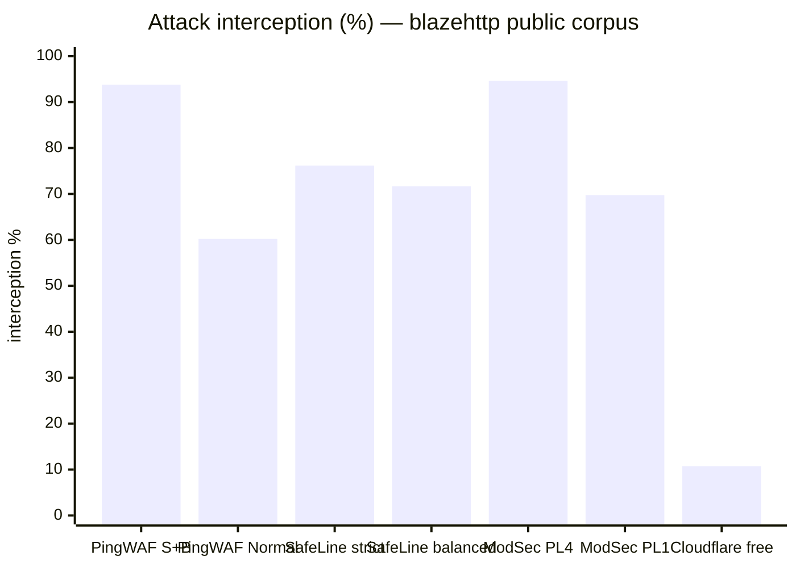
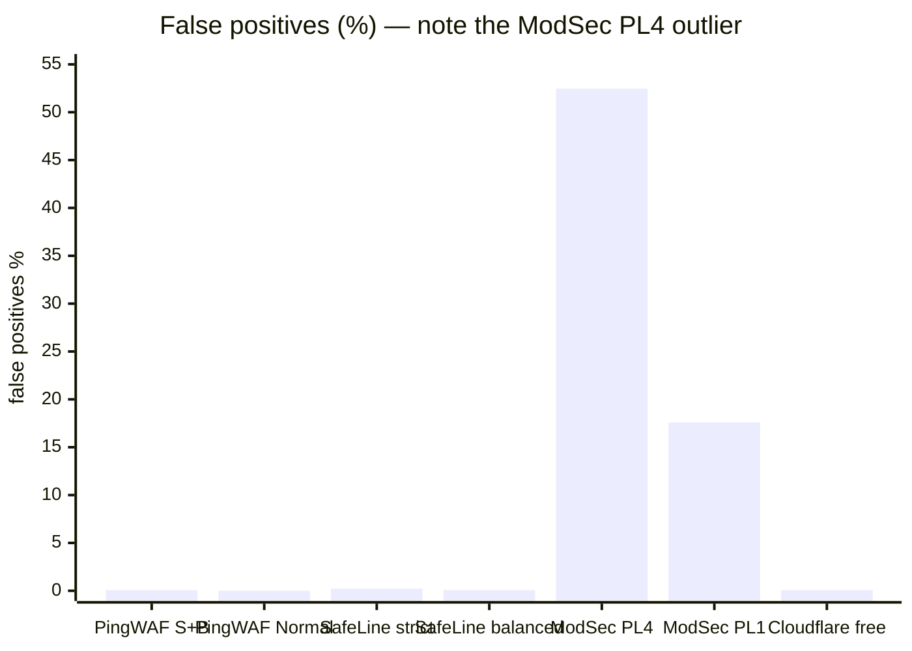

# PingWAF WAF Engine Test Report (0.32.4, post-fix)

- Version under test: `0.32.4` (`Cargo.toml` `[workspace.package]`)
- Test date: 2026-11-02 (second run, after the defect fixes below)
- Dataset: [chaitin/blazehttp](https://github.com/chaitin/blazehttp) —
  33 877 raw HTTP samples (658 malicious / 33 219 benign), plus 10 local
  compressed-body samples shipped in this repository
- Method: [waf-test-plan.md](./waf-test-plan.md) — layered suites, static data
  plane, raw-socket replay
- Raw artefacts: `results/0.32.4/` (`metrics.json` is the single number source
  for every figure below)
- History: [waf-benchmark-report.md](./waf-benchmark-report.md) — the per-round
  appendix this report is measured against

## 1. Verdict

The engine intercepts **93.8 %** of the public malicious corpus at the maximum
tier (Strict + body inspection) with **0.06 %** of benign requests affected, and
**60.2 %** at the default tier (Normal, no body inspection) with **0.01 %**.
Static-tier latency stays at p95 ≤ 2 ms.

| Tier | Intercepted | blocked (403) | challenged (503) | Benign affected | p50 / p95 | error |
|---|---|---|---|---|---|---|
| Normal | 396/658 = **60.2 %** | 396 | 0 | 4/33 219 = **0.01 %** | 0 / 2 ms | 0 % |
| Normal + body | 473/658 = **71.9 %** | 473 | 0 | 12/33 219 = **0.04 %** | 0 / 2 ms | 0 % |
| Strict | 500/658 = **76.0 %** | 490 | 10 | 4/33 219 = **0.01 %** | 1 / 2 ms | 0 % |
| Strict + body | 617/658 = **93.8 %** | 607 | 10 | 19/33 219 = **0.06 %** | 1 / 2 ms | 0 % |

`blocked` is the 403 block page; `challenged` is the 503 challenge page. Both are
WAF verdicts, so `intercepted` (their sum) is the figure comparable with earlier
rounds; splitting them shows how much of the interception surface costs a
visitor a cookie round trip instead of a refusal.

Interception is **identical to the previous round** (396 / 473 / 500 / 617) while
benign impact dropped by **eight samples on every tier** (12 / 20 / 12 / 27 →
4 / 12 / 4 / 19). That is the two engine fixes in §4 doing exactly what they were
written for: no detection was traded away for the reduction.

Excluding samples no proxy-side inspector can decide (RFC 7230 body-less
requests, protocol/ method-layer rejections, URL fragments), the effective figure
for the recommended tier is **616/638 = 96.6 %**, or **616/635 = 97.0 %** once
the three verdict-layer artefacts are removed as well.

## 2. What was executed

| Layer | Command | Result |
|---|---|---|
| Unit / contract | `cargo test --workspace --features=full` | all green; `pingwaf-waf` **250 tests** |
| End-to-end | 4 tiers × 33 877 samples, `--concurrency 16 --delay-ms 5` | 135 508 verdicts, 0 `error` |
| Compressed bodies | `compressed` suite (8 malicious + 2 benign gzip) × 2 tiers | Strict+body 8/8 and 2/2; Normal+body 7/8 |
| Path equivalence | `spot-advanced` full replay + diff vs Strict+body | 0 gained / 0 lost / 0 flips |
| Monitor downgrade | `spot-monitor-sqli` / `spot-monitor-java` on the smoke suite | 3 SQLi and 2 SSTI samples downgraded exactly |
| Regression | `triage` (20) + `fp-pin` (27) replays | identical to the full run; 8 pinned false positives now pass |
| Determinism | smoke suite replayed twice | 61/61 identical verdicts |
| Footprint | `waf_scale_bench` | 2 / 10 / 100 sites, legacy vs shared |

Environment: macOS arm64, loopback, release binary
`cargo build --release --bin pingwaf --features=full` (34 MiB), static TOML data
plane (`pingwaf -c`), mock origin answering 200 on every request.

## 3. Effectiveness data

### 3.1 Interception by category (malicious samples)

| Category | n | Normal | Normal+body | Strict | Strict+body |
|---|---|---|---|---|---|
| sqli | 20 | 85.0 % (17) | 85.0 % (17) | 85.0 % (17) | 85.0 % (17) |
| xss | 30 | 46.7 % (14) | 46.7 % (14) | 93.3 % (28) | 96.7 % (29) |
| lfi | 25 | 80.0 % (20) | 88.0 % (22) | 84.0 % (21) | 96.0 % (24) |
| rce | 12 | 25.0 % (3) | 50.0 % (6) | 66.7 % (8) | 83.3 % (10) |
| ssrf | 13 | 7.7 % (1) | 61.5 % (8) | 7.7 % (1) | 100 % (13) |
| deser | 6 | 16.7 % (1) | 100 % (6) | 16.7 % (1) | 100 % (6) |
| crlf | 5 | 60.0 % (3) | 60.0 % (3) | 60.0 % (3) | 100 % (5) |
| ssti | 5 | 60.0 % (3) | 60.0 % (3) | 100 % (5) | 100 % (5) |
| xxe | 2 | 0 % (0) | 50.0 % (1) | 50.0 % (1) | 50.0 % (1) |
| log4shell | 1 | 100 % | 100 % | 100 % | 100 % |
| scanner | 1 | 0 % (0) | 0 % (0) | 0 % (0) | 100 % (1) |
| other | 538 | 61.9 % (333) | 72.9 % (392) | 77.0 % (414) | 93.9 % (505) |

Two dimensions do different jobs. Falling between Normal and Strict is dominated
by signatures and managed-rule thresholds (xss 46.7 → 93.3); falling between
static and body inspection is dominated by families whose payload only exists in
the body (ssrf 7.7 → 61.5, deser 16.7 → 100). `other` — the encoded and
obfuscated families — needs both: 61.9 % → 93.9 % only when the tier and body
inspection are raised together.

### 3.2 What is still missed (Strict + body, 41 samples)

| Bucket | n | Status |
|---|---|---|
| POST/PUT without `Content-Length` or `Transfer-Encoding` | 18 of 19 | Artefact: empty body under RFC 7230; the payload never reaches the server (one of the 19 is blocked on its headers anyway) |
| URL fragment payload | 1 | Artefact: stripped by the parser before the request line |
| `protocol_reject` (400/414/431/501) | 2 | HTTP layer, not a WAF verdict |
| `status_405` (method not allowed) | 1 | Method-layer artefact |
| Real engine misses | **19** | all in the `other` (encoded/obfuscated) family |

The effective denominator is 638 (658 minus the 19 body-less and 1 fragment
samples), of which 616 are intercepted — **96.6 %**. Dropping the three
verdict-layer artefacts as well (635 denominator) gives **97.0 %**.

Every remaining miss is an encoded or obfuscated `other` payload; the sqli / rce
/ xss / lfi misses in the raw 658 denominator all come from body-less POST
samples, i.e. from the transport, not from detection.

## 4. False positives after the fixes

Two engine defects from the previous round were fixed this round. Both are
pinned by unit tests and by the `fp-pin` suite.

| Fix | Location | Effect |
|---|---|---|
| Tautology prose gate now recognises CJK-dominated values | `pingwaf-waf/src/rules/signatures.rs` (`tautology_sits_in_prose`) | 7 benign Bing search / telemetry samples (`and 1=1` quoted in Chinese) stop being critical |
| Sensitive-dotfile rule requires a path boundary | `pingwaf-waf/src/rules/managed.rs` (`PINGWAF-1020`) | `.github/…` no longer matches; `.git/config`, `.env`, `.env.local` still do |

Evidence that both are fixed end to end, not just in unit tests:

- the `fp-pin` suite pins the 27 benign samples that were blocked last round;
  replayed now, **8 of them pass** (7 tautology + 1 `.github`) while the other 19
  still intercept;
- benign interception drops by exactly 8 on **every** tier (12 → 4, 20 → 12,
  12 → 4, 27 → 19) with no change to the interception counts.

The 19 remaining benign interceptions at Strict + body:

| Trigger | n | Assessment |
|---|---|---|
| `PINGWAF-1040` wp-admin probe (challenge) | 2 | Challenge, not a block: a legitimate WordPress visitor passes after the cookie round trip. Splitting the bucket makes this visible instead of counting it as a false positive of equal weight |
| `XSS-007` script URI in query | 1 | Intentional: a bare `javascript:` on a reflected surface stays critical |
| `SQL-001` + libinjection union-select | 1 | Known word-level ambiguity (prose quoting a full `union select … from …`) |
| Body-tier families (rce 4, xss 3, lfi 3, other 3, ssti 1, crlf 1) | 15 | Reflected-XSS prose, HTML uploads, CI payloads carrying `/bin/sh` — the structural cost of member-level inspection at the Strict tier |

## 5. Regression and determinism

| Check | Result |
|---|---|
| `triage` (20 currently-missed malicious samples) | replayed: 19 `passed` + 1 `status_405`, byte-identical to the full run |
| `fp-pin` (27 previously blocked benign samples) | replayed: 17 `blocked` + 2 `challenged` + **8 `passed`** — the fixed families stay fixed |
| Smoke suite twice, same configuration | 61/61 identical verdicts, 0 flips |
| `spot-advanced` vs Strict+body, all 33 877 samples | 0 gained, 0 lost, 0 flips |

## 6. Capability checks

| Capability | Evidence |
|---|---|
| Body decompression (gzip / deflate, 1 MiB cap) | **`compressed` suite: 8/8 malicious gzip bodies intercepted at Strict + body, 2/2 benign gzip bodies pass.** Normal + body intercepts 7/8 — the `$(curl … | sh)` command-substitution form stays a Strict-only signal. Before this round the corpus held only benign gzip traffic |
| `br` / `zstd` reported as uninspected | unit tests; corpus has 0 such samples |
| Resource ceilings (expression, normalisation, scan budget) | unit tests for token/depth/size limits; budget exhaustion keeps scanning headers and URI |
| `PINGWAF-1051` demoted to Log | 195 long-URI benign samples (14 of them > 2 KiB, up to 16 711 B) all pass; 12 of the 14 malicious long-URI samples are still intercepted by other families |
| Category monitor (`monitor_categories=["sqli"]`) | SQLi probe passes (200) while `.env` / TRACE stay blocked; in the smoke suite exactly the 3 SQLi samples flip to `passed` and the 2 SSTI samples stay intercepted |
| Stack monitor (`monitor_stacks=["java"]`) | Log4Shell probe passes (200); the 2 SSTI samples flip to `passed` while the 3 SQLi samples stay intercepted |
| Managed rules 15 defined / 13 assembled on Normal | assembly-count unit tests; `PINGWAF-1070` never fires on Normal |

## 7. Performance and footprint

| Tier | p50 | p95 | error rate |
|---|---|---|---|
| Normal | 0 ms | 2 ms | 0 % |
| Normal + body | 0 ms | 2 ms | 0 % |
| Strict | 1 ms | 2 ms | 0 % |
| Strict + body | 1 ms | 2 ms | 0 % |

The body tiers no longer show the ~3 s p95 of earlier rounds: the mock origin
drains request bodies, so a blocked upload does not leave the client mid-
`sendall`. The metric is dominated by the harness, not the engine — it is
reported, not gated.

Footprint (`waf_scale_bench`, tracking allocator over the system allocator;
relative values only):

| Mode | 2 sites | 10 sites | 100 sites | Incremental per site |
|---|---|---|---|---|
| legacy (per-site engine) | 242 940 B | 1 214 700 B | 12 147 000 B | ~121 KB |
| shared base | 1 260 107 B | 1 262 347 B | 1 287 547 B | 280 B |

Shared mode keeps the Aho-Corasick automaton and managed rules in one base
object: 100 sites cost 1.29 MB retained instead of 12.1 MB — a 9.4× reduction —
at the price of a one-off 1.26 MB base (5.83 MB peak during construction).

## 8. Cross-vendor comparison

Numbers for other products are **quoted from the blazehttp project README**
(its own benchmark section), not measured here — no CloudFlare, SafeLine or
ModSecurity deployment exists in this environment. The two data sets are close
but not identical, and the caveats below matter more than the ranking.

### 8.1 Interception and false positives





| Product / mode | Corpus | Malicious | Interception | Benign | False positives | Accuracy | Latency |
|---|---|---|---|---|---|---|---|
| **PingWAF 0.32.4 Strict+body** | 33 877 | 658 | **93.8 %** (617) | 33 219 | **0.06 %** (19) | **99.82 %** | p95 2 ms (loopback) |
| **PingWAF 0.32.4 Normal** | 33 877 | 658 | **60.2 %** (396) | 33 219 | **0.01 %** (4) | **99.21 %** | p95 2 ms (loopback) |
| SafeLine free · strict | 33 669 | 575 | 76.17 % (438) | 33 094 | 0.22 % (73) | 99.38 % | 64.34 ms (public) |
| SafeLine free · balanced | 33 669 | 575 | 71.65 % (412) | 33 094 | 0.07 % (23) | 99.45 % | 70.05 ms (public) |
| ModSecurity PL4 | 33 669 | 575 | 94.61 % (544) | 33 094 | 52.46 % (17 362) | 48.34 % | 28.89 ms (public) |
| ModSecurity PL1 | 33 669 | 575 | 69.74 % (401) | 33 094 | 17.58 % (5 819) | 82.20 % | 31.15 ms (public) |
| Cloudflare free | 33 669 | 570 | 10.70 % (61) | 32 780 | 0.07 % (23) | 98.40 % | 288.96 ms (public) |

Accuracy follows the blazehttp definition: `(correctly intercepted + correctly
passed) / total samples`. The PingWAF figures are computed on 33 877 samples
with `intercepted` counting both 403 and 503.

### 8.2 What must not be read into this table

- **Different corpus snapshots.** The official table uses 33 669 samples
  (570–575 malicious, 32 780–33 094 benign); this round used 33 877 (658
  malicious, 33 219 benign). The malicious share grew from ~1.7 % to 1.9 %, so
  the two interception rates are not measured over the same denominator.
- **Different latency measurements.** Cloudflare and SafeLine numbers are public
  deployments including network RTT; PingWAF's p95 is a loopback verdict
  latency. They answer different questions and must not be compared as
  throughput or capacity.
- **Different modes.** Cloudflare free, SafeLine balanced/strict and PingWAF
  Normal/Strict+body are not equivalent product tiers; the table shows a range
  per product, not a single "product score".
- **Third-party numbers are as published.** They were not re-run here; the only
  claim this report makes is "on the same public corpus, PingWAF's measured
  position is in this range".

Read together: PingWAF's maximum tier sits next to ModSecurity PL4 and above
SafeLine's strict mode on interception, with a false-positive rate close to
Cloudflare's and SafeLine's balanced mode rather than ModSecurity's. Its default
tier (Normal, no body inspection) is comparable to SafeLine's balanced mode on
false positives but lower on interception — body inspection is where most of the
remaining detections live.

## 9. Findings and remaining work

Fixed this round (all verified by unit tests plus a full replay):

1. Tautology prose gate now demotes CJK-dominated search phrases — 7 false
   positives removed, no detection lost.
2. `PINGWAF-1020` no longer treats `.github` as a dotfile probe — 1 false
   positive removed.
3. The replay calibre now separates `challenged` (503) from `blocked` (403), so a
   challenge no longer reads as a denial; `status_405` / `status_500` have their
   own counters instead of a bare `status_*` row.
4. The corpus now covers compressed attack bodies end to end (`compressed`
   suite), with a reproducible generator.
5. Artefact denominators are documented per bucket (byte-level vs verdict-level)
   in both the plan and this report.

Still open:

1. **Normal + body misses one compressed form** (`$(curl … | sh)`). Splitting the
   command-substitution signature out of Strict-only would close it; the trade-
   off is false positives from legitimate `$(…)` in form fields, so it needs a
   counted release, not a blind move.
2. **`PINGWAF-1040` still challenges legitimate WordPress traffic.** A challenge
   is cheaper than a block, but a CMS-specific rule needs a stack condition
   (`stacks=["php"]`) rather than firing on every site.
3. **19 encoded/obfuscated misses remain** at Strict + body. They are the same
   multi-layer families documented in the benchmark appendix; each round now
   closes a handful while keeping false positives flat.
4. **The official comparison data is a snapshot.** Re-pulling it when the
   upstream README changes is a documentation task, not a test task.

## 10. Limitations

- Static TOML data plane only. Agent-mode behaviour (auto-block, log shipping,
  clearance cookies) is out of scope; without an agent `log_event` is a no-op,
  so a monitor verdict is not observable here.
- No TLS / HTTP/2 / HTTP/3 coverage: the matrix is plaintext HTTP/1.1.
- Throughput is not measured. `replay.py` is a fidelity replayer, not a load
  generator; the 16-thread / 5 ms pacing is deliberate (32/0 produced 1.4 %
  connect timeouts).
- Category labels come from a heuristic regex in `replay.py`; they are a
  reporting dimension, not a verdict.
- Absolute footprint numbers are relative: the scale example uses a tracking
  allocator over the system allocator, while the shipped binary uses mimalloc.
- The 19 real misses were classified by category only; per-sample attribution
  stays in the benchmark appendix's iteration history.
- Third-party comparison figures are quoted, not re-measured (§8.2).

## 11. Reproducing

```bash
git clone --depth 1 https://github.com/chaitin/blazehttp /tmp/blazehttp
export BLAZEHTTP_ROOT=/tmp/blazehttp
python3 tools/waf-bench/make_local_samples.py     # 8 malicious + 2 benign gzip
cargo test --workspace --features=full
cargo build --release --bin pingwaf --features=full

./tools/waf-bench/run_suite.sh \
  --conf tools/waf-bench/conf/level-strict-body.toml \
  --suite full --group strict-body --out results/0.32.4/strict-body \
  --concurrency 16 --delay-ms 5
./tools/waf-bench/run_suite.sh \
  --conf tools/waf-bench/conf/level-strict-body.toml \
  --suite compressed --group compressed-strict-body \
  --out results/0.32.4/compressed-strict-body --concurrency 2 --delay-ms 10

python3 tools/waf-bench/diff.py \
  results/0.32.4/strict-body/run.jsonl results/0.32.4/spot-advanced/run.jsonl
python3 tools/waf-bench/suites.py pin \
  --jsonl results/0.32.4/strict-body/run.jsonl --suite triage --suite fp-pin
```

`results/0.32.4/metrics.json` holds every figure quoted above, including the
comparison rows and their source note.
