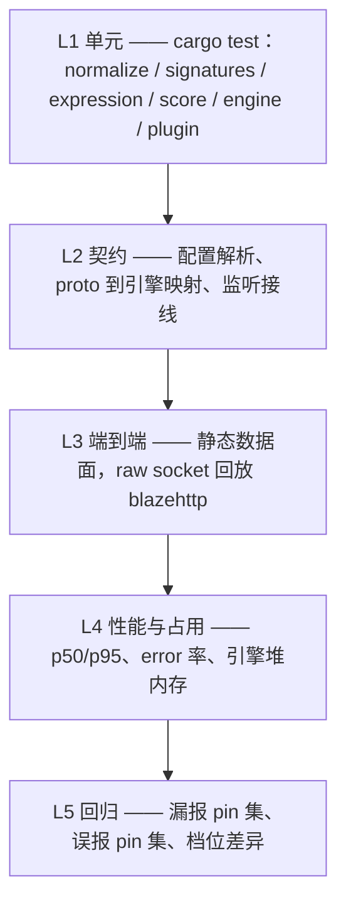

# PingWAF WAF 引擎测试方案

- 被测版本：`0.32.4`（`Cargo.toml` 的 `[workspace.package]`）
- 范围：`pingwaf-waf` 检测引擎、`pingap-plugin` 的 WAF 集成，以及执行这两者的静态数据面路径
- 数据集：[chaitin/blazehttp](https://github.com/chaitin/blazehttp)——33 877 条原始 HTTP 报文（恶意 658 / 正常 33 219）
- 配套文档：[waf-test-report.md](../waf-test-report.md)（本轮实测结果）、
  [waf-benchmark-report.md](../waf-benchmark-report.md)（P0 → P14 逐轮数据附录）、
  [waf-engine-review.md](../waf-engine-review.md)（引擎复盘与设计依据）

本方案取代"跑一遍回放脚本、看一眼汇总"的松散做法，改为分层、可重复执行的套件。
效果报告中的每一个数字都来自本文定义的一条命令。

## 1. 相对上一基线的变化

上一版公开基线（`0.20.0`，基准报告 §21）已不能描述当前引擎。下列行为正是本方案存在的原因，每一条都带着对应的测试义务。

| 变化 | 行为 | 测试义务 |
|---|---|---|
| 托管规则集 | 共定义 15 条；Normal 档装配 13 条，`PINGWAF-1061`、`PINGWAF-1070` 仅 Strict 装配（`pingwaf-waf/src/rules/managed.rs`） | 断言两档装配条数；Strict-only 规则在 Normal 档必须永不命中 |
| 请求体解压 | 解码 `gzip` / `x-gzip` / `deflate`，上限 1 MiB（`MAX_DECOMPRESSED_BODY`）；`br`、`zstd` **不解码**并标记为未检测（`normalize/body.rs`） | 压缩载荷必须拦得住；超限必须截断并标记，不能静默放行；不支持的编码必须可观测 |
| 资源上限 | 表达式：16 KiB / 512 token / 深度 64 / 正则缓存 4 MiB / 512 条。归一化：query 256 对、解码值 2 048 个、单值 8 KiB、JSON 深度 6、64 值 × 4 KiB、multipart 64 段、b64 深度 2、16 KiB。进程扫描预算：默认 128 MiB，clamp 8 MiB – 1 GiB（`engine/mod.rs`） | 上限必须截断、不得 panic、不得静默 fail-open；预算耗尽时仍须扫描头部与 URI |
| 监听降级 | 分类（`monitor_categories`）、后端栈（`monitor_stacks`）、单规则三类监听只进总分、不进拦截分（`engine/mod.rs`、`pingap-plugin/src/waf.rs`） | 监听集为空时判决必须与旧实现逐位一致；被降级的命中必须在判决详情里可见 |
| `advanced_mode` | 等价于 Strict 档 + 请求体检测；设置后忽略 `level` | 与 `level = "strict"` + `inspect_body = true` 做路径等价性检查 |
| `PINGWAF-1051` | 超长 URI 规则由 `Block` 降为 `Log` | 超长 URI 样本在所有档位必须放行；规则仍须出现在装配结果中 |

## 2. 分层

五层，每层的运行成本与失败信号都不同。上层只允许依赖下层。



### 2.1 L1 —— 单元

`cargo test -p pingwaf-waf --lib` 加上 `pingap-plugin/src/waf.rs` 中的插件测试。
2026-11-02 实测：`pingwaf-waf` 共 **250 个用例**（engine 124、signatures 47、normalize 22、body 13、expression 13、path 7、html 7、managed 7、url 6、score 4），另有插件套件。

各区域必须覆盖的断言：

| 区域 | 必测内容 |
|---|---|
| normalize | query / form / JSON / header / cookie / path 各入口；`+` 仅在表单值中按空格解码；overlong UTF-8；percent 复解码 |
| body | gzip、deflate、多层编码、1 MiB 上限、截断流、不支持的 `br`/`zstd` |
| expression | token / 深度 / 体积上限；编译失败必须上报，不得静默丢弃 |
| signatures | leftmost-longest 匹配语义；needle 族；档位门控（`strict_only`） |
| 引擎判决 | pass / monitor / block / challenge 优先级；Stage-1 critical 短路；监听子集不计入拦截分 |
| 插件 | `max_body_size` clamp、`anomaly_threshold` 回落、未知 `level`、未知监听名 |

### 2.2 L2 —— 契约

本仓库目前没有 `tests/` 目录，契约层因此是一组固定映射关系的 crate 内测试，而不是独立的集成 crate。两个方向必须钉住：

- 控制面 → agent 缓存 → `build_site_engine` → 判决，使用进程内 agent 句柄（`pingwaf-agent/src/lib.rs`），不启真实 gRPC 服务；
- 静态 TOML → 插件配置 → 引擎配置，覆盖 §1 中列出的每个默认值与 clamp 边界。

### 2.3 L3 —— 端到端

只用静态数据面：一个 `pingwaf -c <conf>` 进程挂在 `tools/waf-bench/mock_origin.py` 后面，样本由 `tools/waf-bench/replay.py` 逐字节回放。这是唯一产出拦截率 / 误报率的层。

为什么用静态而不是 agent 模式：静态模式下 auto-block 不存在（唯一写入点需要 agent 句柄），恶意样本不会污染来源 IP 连带后续正常样本，此前"254 地址池不够"的测试工件在此不可能出现。`--xff` 同样无效——只有 `proxy_trust` 开启时才会从 `X-Forwarded-For` 推导 client IP，而该开关默认关闭——所以四档回放都不传它。需要接受的代价：`PINGWAF-1001`（非内网来源访问 `/admin` 质询）在本矩阵中永不触发，改由单元测试覆盖。

### 2.4 L4 —— 性能与占用

- 时延：直接取同一轮回放记录中的 p50 / p95。只有静态档的时延用于门禁。
- body 档：p95 照报但**不设门**——拦截后客户端仍在 `sendall` 大 body，长尾由客户端主导，与匹配开销无关。
- 占用：`cargo run --release -p pingwaf-waf --example waf_scale_bench`（2 / 10 / 100 站点，`legacy` vs `shared`）。数值只作相对基线：示例使用包装系统分配器的统计分配器，而发布二进制用 mimalloc。
- 吞吐明确**不测、不宣称**。`replay.py` 是保真回放器（8 工作线程、10ms 间隔），不是压测工具。

### 2.5 L5 —— 回归

两类回归，因为失败方式不同：

1. **语义回归**——带固定载荷的单元测试，每个测试对应历史轮次发现的一类缺陷。拦过的载荷必须继续被拦；有意放行的载荷必须继续放行。
2. **判决回归**——全量回放与固定基线对比：
   - `triage` 套件：当前引擎放过的恶意样本，钉住后下一轮必须证明是它的严格超集；
   - `fp-pin` 套件：当前被拦的正常样本，钉住后下一轮不得悄悄新增误报；
   - `diff.py` 以样本路径为键比较两次 JSONL，输出 `gained`、`lost` 与判决翻转，忽略时延与分组标签。

每个版本的首次全量回放**生成**下一轮基线，`suites.py pin` 从该轮结果写出两个 pin 清单。

## 3. 复用 blazehttp

### 3.1 数据集事实

| 属性 | 值 |
|---|---|
| 来源 | `git clone --depth 1 https://github.com/chaitin/blazehttp` |
| 结构 | `testcases/**/*.black`（预期拦截）与 `*.white`（预期放行） |
| 规模 | 33 877 条——黑 658 / 白 33 219 |
| 请求体占比 | 30.7% 为 POST |
| 类目标签 | `replay.py` 的 `classify` 启发式正则，11 类 + `other` + `malformed` |

类目标签只是统计维度，从不参与判决。它存在的意义是回答"哪一族退化了"，且只从原始报文推导。

### 3.2 用例选取范围

七个套件，统一在 `tools/waf-bench/suites.json` 声明：

| 套件 | 选取规则 | 约规模 | 何时跑 |
|---|---|---|---|
| `smoke` | 每类 3 黑 + 3 白，按路径排序 | ~70 | 每次改动；全量前的环境预检 |
| `category` | 全部黑样本 + 每类 50 白 | ~1 200 | 规则 / 签名改动；类别归因 |
| `perf` | 每类 20 黑 + 60 白 | ~900 | 时延与占用检查，控制单轮时长 |
| `full` | 全部 33 877 条 | 33 877 | 发版门禁与效果报告 |
| `compressed` | `tools/waf-bench/local` 下的本地 gzip 样本（8 恶意 + 2 良性） | 10 | 解压链路端到端；上游语料没有恶意压缩体 |
| `triage` | 显式 pin 清单，由上一轮 `full` 的漏报黑样本播种 | 逐步增长 | 证明"没有漏报回退" |
| `fp-pin` | 显式 pin 清单，由上一轮 `full` 的误报白样本播种 | 逐步增长 | 证明"没有新增误报" |

`compressed` 样本不进入上游套件，保证主表数字与历史轮次可比。用
`python3 tools/waf-bench/make_local_samples.py` 生成（输出确定，可重复）。

固定规模套件的规则：按 `suites.json` 声明的类目顺序遍历，样本按相对路径排序后取前 N。按路径排序使选取在不同 clone 与机器上稳定——无随机、无需记录种子。

### 3.3 磁盘组织

```
tools/waf-bench/suites.json          # 选取规则的唯一真源
tools/waf-bench/suites.py            # build / check / pin / stats
tools/waf-bench/run_suite.sh         # 起上游与数据面、回放、汇总、清理
tools/waf-bench/diff.py              # 两次 JSONL 的判决差异
results/<version>/<group>/run.jsonl  # 逐样本判决（不入库）
results/<version>/<group>/summary.md # 汇总表（入库）
results/<version>/metrics.json       # 报告的唯一数字来源（入库）
```

`suites.py build` 把套件物化为镜像数据集相对路径的符号链接树，`replay.py` 因此报出与直接回放数据集完全一致的 `file` 值。预期只由 `.black` / `.white` 后缀决定，无需分组：

```
<out>/<相对路径>   # 指向数据集样本的符号链接
```

`suites.py check` 校验清单与数据集：pin 必须存在、每个类目都有样本、样本不重复选中、黑白数量与清单一致。

### 3.4 排除与工件口径

部分 blazehttp 样本任何反代侧 WAF 都拦不住，不计入"漏报"头条，单独列出：

| 工件 | 数量 | 原因 |
|---|---|---|
| 无 `Content-Length` 且无 `Transfer-Encoding` 的 POST/PUT | ~34 | RFC 7230：无帧界定即空 body，载荷到不了服务器 |
| `status_405`（方法不允许） | 1 | 方法层在 WAF 之前拒绝，与下一行同属传输面工件 |
| `protocol_reject`（400/414/431/501） | ~3 | HTTP 层拒绝，不是 WAF 判决，仅在宽口径计数 |
| URL fragment 载荷 | 1 | `#fragment` 在请求行进入任何处理器前就被剥离，载荷同样到不了源站 |
| SSRF 弱语义 | ~2 | 内网 URL 字面量与诚实流量同构 |
| 合成 XSS 洋葱 + 未授权 API 族 | ~3 | 请求检测面不可判 |

因此报告同时给出原始分母与等效分母，永远带标签。

## 4. 矩阵

| 组 | 配置 | 证明什么 |
|---|---|---|
| `normal` | `level-normal.toml` | 默认档，不检测请求体 |
| `normal-body` | `level-normal-body.toml` | 默认档 + 请求体检测——推荐生产形态 |
| `strict` | `level-strict.toml` | Strict 档，不检测请求体 |
| `strict-body` | `level-strict-body.toml` | Strict 档 + 请求体检测——最大检测面 |
| `spot-advanced` | `spot-advanced.toml` | `advanced_mode` 与 `strict-body` 的路径等价性 |
| `spot-monitor-sqli` | `spot-monitor-sqli.toml` | 分类监听：SQLi 可见但不拦 |
| `spot-monitor-java` | `spot-monitor-java.toml` | 栈监听：Java 载荷降级 |

所有配置监听 `127.0.0.1:6188`，上游 `127.0.0.1:6199`。

执行顺序：

1. `cargo test --workspace --features=full`（§2.1、§2.2）。
2. `cargo build --release --bin pingwaf --features=full`。
3. 起 `mock_origin.py`，按档起数据面并跑探针（SQLi 命中、dotfile 命中、TRACE 拦截、扫描器 UA、每档一条 Strict-only 探针）——TOML 键写错会被静默忽略，探针是"规则真的装配了"的唯一证据。
4. 四档跑 `smoke` 套件（快速，暴露环境故障）。
5. 四档全量回放，`--concurrency 32 --delay-ms 0`。
6. `spot-*` 跑 `smoke` 套件。
7. 从 `strict-body` 全量结果 `suites.py pin`，再回放 `triage` 与 `fp-pin` 各一次确认确定性。
8. `waf_scale_bench` 取占用基线。

## 5. 度量口径

### 5.1 判决

| verdict | 来源 |
|---|---|
| `blocked` | 403（block 页）：请求被拒绝 |
| `challenged` | 503（challenge 页）：WAF 判决，但代价是一次 cookie 往返 |
| `intercepted` | 派生：`blocked` + `challenged`，主拦截率用它 |
| `passed` | 2xx / 3xx，到达 mock 上游 |
| `protocol_reject` | HTTP 层的 400 / 413 / 414 / 431 / 501 |
| `status_405` | 方法层在 WAF 之前拒绝 |
| `rate_limited` | 429 |
| `error` | 超时、连接重置、响应不可读 |
| `status_<code>` | 其它，原样记录 |

主拦截率用 `intercepted`，这样与 403/503 共用一个桶的历史轮次保持可比。误报表把 `blocked` 与 `challenged` 分开：质询是让访客多走一步，拦截是直接拒绝，两者不是同一种产品缺陷。宽口径另加 `protocol_reject` 与 `error`，仅用于与官方 blazehttp 二进制对账（它区分不了 WAF 判决与解析层拒绝）。

每份报告都必须记录的已知缺口：插件自身可返回 `408`、`413`、`415`（压缩体超限、不支持的编码、请求体过大）。`replay.py` 把 `413` 归到 `protocol_reject`，其余落到 `status_<code>`，因此压缩相关的拒绝不以 WAF 判决形态呈现。报告显式打印这些计数，而不是把它们并进拦截率。

### 5.2 性能

| 指标 | 口径 | 门禁 |
|---|---|---|
| 静态档 p50 / p95 | 该档全部样本，环回，含建连 | p95 ≤ 10 ms |
| body 档 p50 | 同一轮 | p50 ≤ 静态 p50 + 5 ms |
| body 档 p95 | 照报，不设门 | —（客户端 `sendall` 长尾） |
| `error_rate` | 该档全部样本 | ≤ 0.2% |
| 引擎占用 | `waf_scale_bench`，2 / 10 / 100 站点 | 记录绝对值；不设跨机门禁 |

## 6. 验收门槛

一轮全部满足才算通过：

1. `cargo test --workspace --features=full`——0 失败；`pingwaf-waf` 用例数与报告引用一致。
2. `make lint`——typos 与 clippy 干净。
3. 四档：`error_rate` ≤ 0.2%；任何档位不得丢失 `triage` 样本，不得新增 `fp-pin` 样本。
4. 各档拦截率不低于上一轮，除非下降被归因到某个明确的、已记录在案的语义变更。
5. 各档误报率 ≤ 0.2%（沿用上一版目标线；当前引擎远低于此线）。
6. 静态档 p95 ≤ 10 ms；占用数值已记录。
7. 报告发布后 `make check-docs` 与 `cd site && npm run verify` 通过。

失败处理：丢失样本或新增误报直接阻断本轮。改动代码之前必须先归因三类之一——引擎缺陷、回放工件（见 §3.4）、有意的语义变更。只有第一类转成引擎任务；第二类修回放链路后重跑；第三类连同代价写进报告。

## 7. 复现一轮

```bash
# 0. 数据集（一次性）
git clone --depth 1 https://github.com/chaitin/blazehttp /tmp/blazehttp
export BLAZEHTTP_ROOT=/tmp/blazehttp

# 1. 单元与契约层
cargo test --workspace --features=full

# 2. 静态数据面
cargo build --release --bin pingwaf --features=full
python3 tools/waf-bench/suites.py check --root "$BLAZEHTTP_ROOT"
./tools/waf-bench/run_suite.sh \
  --conf tools/waf-bench/conf/level-strict-body.toml \
  --suite full --group strict-body \
  --binary target/release/pingwaf --root "$BLAZEHTTP_ROOT" \
  --out results/0.32.4/strict-body --concurrency 32 --delay-ms 0

# 3. 从该轮结果 pin 回归集
python3 tools/waf-bench/suites.py pin \
  --jsonl results/0.32.4/strict-body/run.jsonl --suite triage --suite fp-pin

# 4. 引擎占用
cargo run --release -p pingwaf-waf --example waf_scale_bench > results/0.32.4/scale.txt

# 5. 汇总给报告用
python3 tools/waf-bench/summarize.py results/0.32.4/*/run.jsonl \
  > results/0.32.4/summary.md
```

## 8. 不测项与理由

| 排除项 | 理由 |
|---|---|
| `e2e/`（Playwright） | 控制台 UI 行为，不是引擎检测；由它自己的套件覆盖 |
| challenge 闭环 | 需要浏览器解 PoW 并保存 clearance cookie |
| auto-block / 600s 封禁 | 只在挂 agent 时存在，`-c` 路径不可达 |
| TLS / HTTP/2 / HTTP/3 | 矩阵按设计为明文 HTTP/1.1；h2 无 Content-Length 由单元测试覆盖 |
| 以 monitor 档做检测结论 | 无 agent 时 `log_event` 直接返回，"0 拦截"不可证伪 |
| 跨机绝对吞吐 / 内存 | 依赖硬件、分配器与内核；只有相对数值有意义 |
| 原始 658 分母上的 95% 拦截 | 物理不可达：§3.4 工件，加上任何请求检测面都无法判决的样本（分析见基准报告） |

## 9. 与既有文档的关系

- 本方案定义一轮**怎么跑**、什么算通过。
- [waf-test-report.md](../waf-test-report.md) 记录当前版本**测到了什么**，数字取自 `results/<version>/metrics.json`。
- [waf-benchmark-report.md](../waf-benchmark-report.md) 仍是**详细数据附录**：P0 → P14 逐轮迭代史、类别表与每道语义门的取舍理由。
- [waf-engine-review.md](../waf-engine-review.md) 仍是**设计记录**：某个检测器为什么存在、为哪种失败形态而建。
