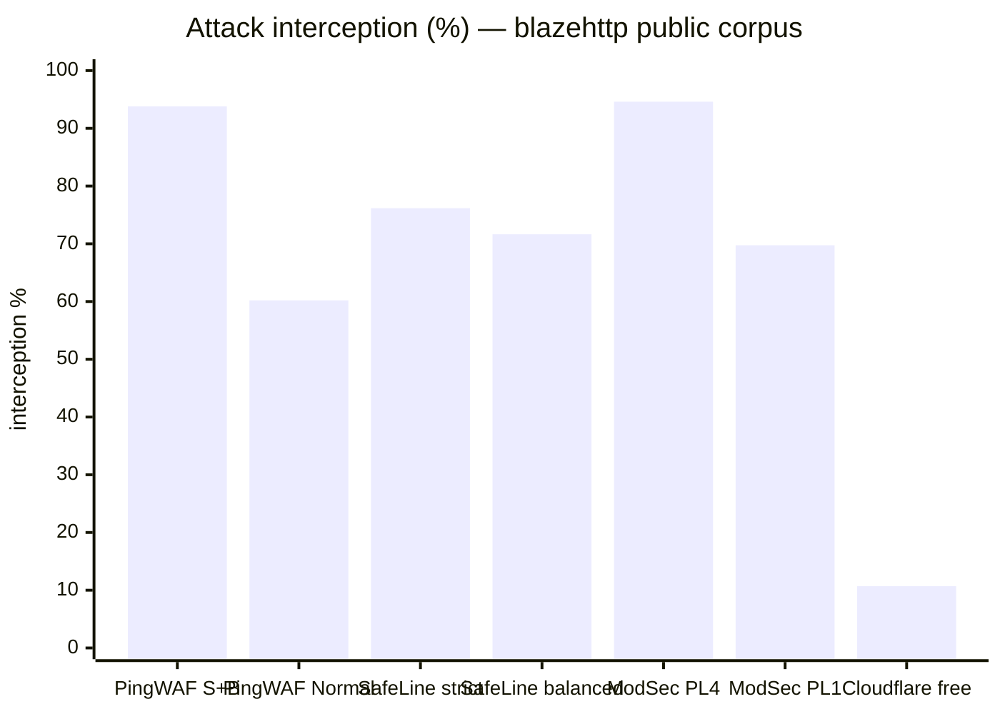
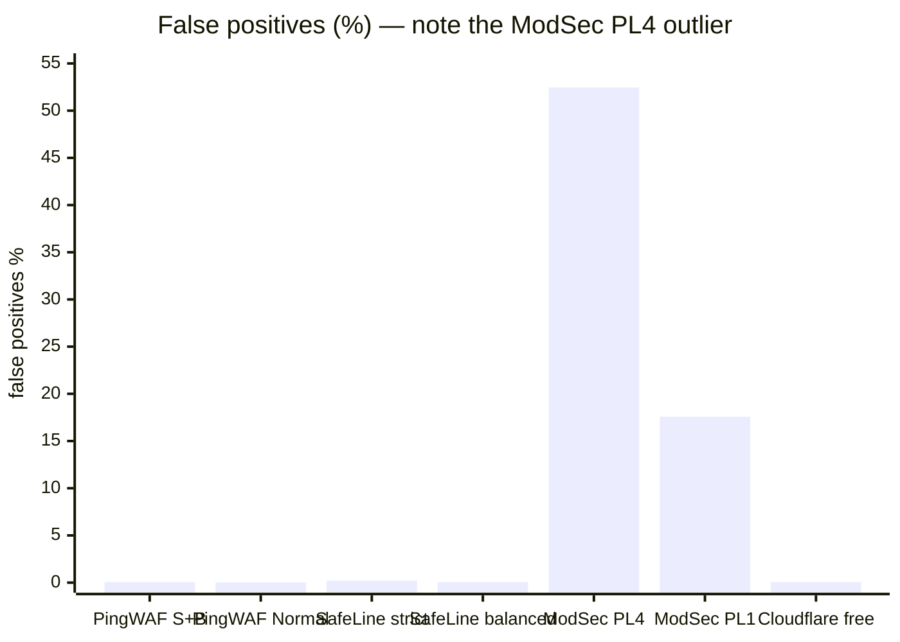

# PingWAF WAF 引擎测试效果报告（0.32.4，修复后）

- 被测版本：`0.32.4`（`Cargo.toml` 的 `[workspace.package]`）
- 测试日期：2026-11-02（第二轮，缺陷修复之后）
- 数据集：[chaitin/blazehttp](https://github.com/chaitin/blazehttp)——33 877 条原始 HTTP 报文（恶意 658 / 正常 33 219），另加本仓库自带的 10 条压缩体样本
- 方法：[waf-test-plan.md](waf-test-plan.md)——分层套件、静态数据面、raw socket 回放
- 原始产物：`results/0.32.4/`（下文每个数字的唯一来源是 `metrics.json`）
- 历史对照：[waf-benchmark-report.md](../waf-benchmark-report.md)——逐轮数据附录

## 1. 结论

引擎在最高档（Strict + 请求体检测）拦截 **93.8%** 的公开恶意样本，受影响正常流量 **0.06%**；默认档（Normal，不检测请求体）拦截 **60.2%**，受影响正常流量 **0.01%**。静态档时延 p95 ≤ 2 ms。

| 档位 | 拦截总数 | blocked（403） | challenged（503） | 正常样本受影响 | p50 / p95 | error |
|---|---|---|---|---|---|---|
| Normal | 396/658 = **60.2%** | 396 | 0 | 4/33 219 = **0.01%** | 0 / 2 ms | 0% |
| Normal + body | 473/658 = **71.9%** | 473 | 0 | 12/33 219 = **0.04%** | 0 / 2 ms | 0% |
| Strict | 500/658 = **76.0%** | 490 | 10 | 4/33 219 = **0.01%** | 1 / 2 ms | 0% |
| Strict + body | 617/658 = **93.8%** | 607 | 10 | 19/33 219 = **0.06%** | 1 / 2 ms | 0% |

`blocked` 是 403 拦截页，`challenged` 是 503 质询页。两者都是 WAF 判决，因此 `intercepted`（两列之和）才是与历史轮次可比的数字；拆开则能看出有多少拦截面是让访客走一次 cookie 往返而不是直接拒绝。

拦截总数**与上一轮完全相同**（396 / 473 / 500 / 617），而正常样本受影响数在**每一档都减少了 8 条**（12 / 20 / 12 / 27 → 4 / 12 / 4 / 19）。这正是 §4 的两处引擎修复在起作用：没有用检出能力换取误报下降。

剔除任何请求面都无法判决的样本（RFC 7230 下无 body 的请求、协议层/方法层拒绝、URL fragment）后，推荐档的有效成绩为 **616/638 = 96.6%**；若再把 3 条判决级工件一并剔除（分母 635），为 **97.0%**。

## 2. 实际执行内容

| 层次 | 命令 | 结果 |
|---|---|---|
| 单元 / 契约 | `cargo test --workspace --features=full` | 全绿；`pingwaf-waf` **250 个用例** |
| 端到端 | 4 档 × 33 877 样本，`--concurrency 16 --delay-ms 5` | 135 508 条判决，`error` 0 |
| 压缩请求体 | `compressed` 套件（8 恶意 + 2 良性 gzip）× 2 档 | Strict+body 8/8 与 2/2；Normal+body 7/8 |
| 路径等价 | `spot-advanced` 全量回放 + diff 对比 Strict+body | 0 gained / 0 lost / 0 翻转 |
| 监听降级 | `spot-monitor-sqli` / `spot-monitor-java` 跑 smoke | SQLi 3 条、SSTI 2 条精确降级 |
| 回归 | `triage`（20）+ `fp-pin`（27）回放 | 与全量逐条一致；8 条 pinned 误报转为放行 |
| 确定性 | smoke 套件连跑两次 | 61/61 判决一致 |
| 占用 | `waf_scale_bench` | 2 / 10 / 100 站点，legacy vs shared |

环境：macOS arm64、环回、release 二进制（`cargo build --release --bin pingwaf --features=full`，34 MiB）、静态 TOML 数据面（`pingwaf -c`）、mock 上游对所有请求返回 200。

## 3. 效果数据

### 3.1 分类拦截率（恶意样本）

| 类目 | n | Normal | Normal+body | Strict | Strict+body |
|---|---|---|---|---|---|
| sqli | 20 | 85.0%（17） | 85.0%（17） | 85.0%（17） | 85.0%（17） |
| xss | 30 | 46.7%（14） | 46.7%（14） | 93.3%（28） | 96.7%（29） |
| lfi | 25 | 80.0%（20） | 88.0%（22） | 84.0%（21） | 96.0%（24） |
| rce | 12 | 25.0%（3） | 50.0%（6） | 66.7%（8） | 83.3%（10） |
| ssrf | 13 | 7.7%（1） | 61.5%（8） | 7.7%（1） | 100%（13） |
| deser | 6 | 16.7%（1） | 100%（6） | 16.7%（1） | 100%（6） |
| crlf | 5 | 60.0%（3） | 60.0%（3） | 60.0%（3） | 100%（5） |
| ssti | 5 | 60.0%（3） | 60.0%（3） | 100%（5） | 100%（5） |
| xxe | 2 | 0%（0） | 50.0%（1） | 50.0%（1） | 50.0%（1） |
| log4shell | 1 | 100% | 100% | 100% | 100% |
| scanner | 1 | 0%（0） | 0%（0） | 0%（0） | 100%（1） |
| other | 538 | 61.9%（333） | 72.9%（392） | 77.0%（414） | 93.9%（505） |

两个维度各司其职。Normal → Strict 的增量主要由签名与托管规则阈值贡献（xss 46.7 → 93.3）；静态 → body 的增量主要由载荷只存在于请求体的家族贡献（ssrf 7.7 → 61.5、deser 16.7 → 100）。`other`（编码与混淆家族）需要两者同时提升，才能从 61.9% 走到 93.9%。

### 3.2 仍然漏掉的样本（Strict + body，41 条）

| 分层 | n | 说明 |
|---|---|---|
| 无 `Content-Length` / `Transfer-Encoding` 的 POST/PUT | 18 / 共 19 | 工件：RFC 7230 下 body 为空，载荷到不了服务器（19 条中 1 条仅凭头部即被拦） |
| URL fragment 载荷 | 1 | 工件：进入请求行前已被解析器剥离 |
| `protocol_reject`（400/414/431/501） | 2 | HTTP 层拒绝，不是 WAF 判决 |
| `status_405`（方法不允许） | 1 | 方法层工件 |
| 引擎真实漏报 | **19** | 全部位于 `other`（编码/混淆）家族 |

有效分母为 638（658 减去 19 条无 body 与 1 条 fragment），其中 616 条被拦——**96.6%**。若再把 3 条判决级工件剔除（分母 635），为 **97.0%**。

剩余漏报全部是编码或混淆形态的 `other` 载荷；原始 658 分母下的 sqli / rce / xss / lfi 漏报全部来自无 body 的 POST 样本，属传输面而非检测面。

## 4. 修复后的误报

本轮修复了上一轮定位的两处引擎缺陷，两者都有单测与 `fp-pin` 套件双重固定。

| 修复 | 位置 | 效果 |
|---|---|---|
| tautology 散文门识别以 CJK 为主的取值 | `pingwaf-waf/src/rules/signatures.rs`（`tautology_sits_in_prose`） | 7 条 Bing 搜索/埋点样本（中文引用的 `and 1=1`）不再被判 critical |
| 敏感 dotfile 规则要求路径边界 | `pingwaf-waf/src/rules/managed.rs`（`PINGWAF-1020`） | `.github/…` 不再命中；`.git/config`、`.env`、`.env.local` 仍命中 |

端到端证据（不只是单测）：

- `fp-pin` 套件固定了上一轮被拦的 27 条正常样本；现在回放其中 **8 条转为放行**（7 条 tautology + 1 条 `.github`），其余 19 条仍被拦；
- 正常样本受影响数在**每一档都恰好减少 8 条**（12 → 4、20 → 12、12 → 4、27 → 19），拦截数没有任何变化。

Strict + body 剩余的 19 条正常样本拦截：

| 触发点 | n | 评估 |
|---|---|---|
| `PINGWAF-1040` wp-admin 探测（质询） | 2 | 是质询而非拦截：合法 WordPress 访客走一次 cookie 往返即可通过。拆桶后这条不再与"拒绝服务"等权计入误报 |
| `XSS-007` query 源 script URI | 1 | 有意保留：反射面的裸 `javascript:` 维持 critical |
| `SQL-001` + libinjection union-select | 1 | 已知词法歧义（散文引用了完整的 `union select … from …`） |
| body 档家族（rce 4、xss 3、lfi 3、other 3、ssti 1、crlf 1） | 15 | 反射型 XSS 散文、HTML 上传、携带 `/bin/sh` 的 CI 载荷——Strict 档成员级检测的结构性代价 |

## 5. 回归与确定性

| 检查 | 结果 |
|---|---|
| `triage`（当前漏报的 20 条恶意样本） | 回放：19 条 `passed` + 1 条 `status_405`，与全量逐条一致 |
| `fp-pin`（上一轮被拦的 27 条正常样本） | 回放：17 条 `blocked` + 2 条 `challenged` + **8 条 `passed`**——已修家族保持修复 |
| smoke 套件同配置连跑两次 | 61/61 判决一致，0 翻转 |
| `spot-advanced` 对比 Strict+body（全部 33 877 条） | 0 gained、0 lost、0 翻转 |

## 6. 能力验证

| 能力 | 证据 |
|---|---|
| 请求体解压（gzip / deflate，1 MiB 上限） | **`compressed` 套件：Strict+body 档 8/8 恶意 gzip 载荷被拦、2/2 良性 gzip 放行。** Normal+body 档 7/8——`$(curl … | sh)` 命令替换形态仍属 Strict-only 信号。本轮之前语料只有良性 gzip 流量 |
| `br` / `zstd` 标记为未检测 | 单测覆盖；样本集 0 条 |
| 资源上限（表达式、归一化、扫描预算） | token / 深度 / 体积上限单测；预算耗尽时仍扫描头部与 URI |
| `PINGWAF-1051` 降为 Log | 195 条超长 URI 正常样本（14 条 > 2 KiB，最长 16 711 B）全部放行；14 条恶意超长 URI 中 12 条仍由其他家族拦下 |
| 分类监听（`monitor_categories=["sqli"]`） | SQLi 探针 200，`.env` / TRACE 仍 403；smoke 中恰好 3 条 SQLi 翻为 `passed`，2 条 SSTI 仍被拦 |
| 栈监听（`monitor_stacks=["java"]`） | Log4Shell 探针 200；2 条 SSTI 翻为 `passed`，3 条 SQLi 仍被拦 |
| 托管规则 15 条定义 / Normal 装配 13 条 | 装配条数单测；`PINGWAF-1070` 在 Normal 档永不命中 |

## 7. 性能与占用

| 档位 | p50 | p95 | error 率 |
|---|---|---|---|
| Normal | 0 ms | 2 ms | 0% |
| Normal + body | 0 ms | 2 ms | 0% |
| Strict | 1 ms | 2 ms | 0% |
| Strict + body | 1 ms | 2 ms | 0% |

本轮 body 档不再出现早期轮次 ~3 s 的 p95：mock 上游会排空请求体，被拦的上传不会让客户端卡在 `sendall`。该指标由回放链路主导而非引擎，只报不设门。

占用（`waf_scale_bench`，统计分配器包装系统分配器；只作相对值）：

| 模式 | 2 站点 | 10 站点 | 100 站点 | 每站点增量 |
|---|---|---|---|---|
| legacy（每站点独立引擎） | 242 940 B | 1 214 700 B | 12 147 000 B | ~121 KB |
| shared（共享基座） | 1 260 107 B | 1 262 347 B | 1 287 547 B | 280 B |

共享模式把 Aho-Corasick 自动机与托管规则留在同一个基座对象里：100 个站点常驻 1.29 MB，而不是 12.1 MB——降低 9.4 倍，代价是一次性 1.26 MB 基座（构建期峰值 5.83 MB）。

## 8. 横向对比

其他产品的数据**引自 blazehttp 项目 README 的官方评测章节**，本轮并未实测——本环境没有 CloudFlare、雷池（SafeLine）或 ModSecurity 的部署。两组数据接近但不同源，下面的口径说明比排名更重要。

### 8.1 检出率与误报率





| 产品 / 模式 | 样本 | 恶意 | 检出率 | 正常 | 误报率 | 准确率 | 耗时 |
|---|---|---|---|---|---|---|---|
| **PingWAF 0.32.4 Strict+body** | 33 877 | 658 | **93.8%**（617） | 33 219 | **0.06%**（19） | **99.82%** | p95 2 ms（环回） |
| **PingWAF 0.32.4 Normal** | 33 877 | 658 | **60.2%**（396） | 33 219 | **0.01%**（4） | **99.21%** | p95 2 ms（环回） |
| 雷池免费版 · 严格 | 33 669 | 575 | 76.17%（438） | 33 094 | 0.22%（73） | 99.38% | 64.34 ms（公网） |
| 雷池免费版 · 平衡 | 33 669 | 575 | 71.65%（412） | 33 094 | 0.07%（23） | 99.45% | 70.05 ms（公网） |
| ModSecurity PL4 | 33 669 | 575 | 94.61%（544） | 33 094 | 52.46%（17 362） | 48.34% | 28.89 ms（公网） |
| ModSecurity PL1 | 33 669 | 575 | 69.74%（401） | 33 094 | 17.58%（5 819） | 82.20% | 31.15 ms（公网） |
| Cloudflare 免费版 | 33 669 | 570 | 10.70%（61） | 32 780 | 0.07%（23） | 98.40% | 288.96 ms（公网） |

准确率按 blazehttp 的定义：`(正确拦截 + 正确放行) / 总样本`。PingWAF 的数字在 33 877 样本上计算，`intercepted` 同时计入 403 与 503。

### 8.2 不能从这张表读出的东西

- **样本快照不同。** 官方表用 33 669 条（恶意 570–575，正常 32 780–33 094）；本轮用 33 877 条（恶意 658，正常 33 219）。恶意占比从约 1.7% 升到 1.9%，两组检出率并非同一分母。
- **耗时测量方式不同。** Cloudflare 与雷池是公网部署实测，含网络 RTT；PingWAF 的 p95 是环回判决时延。两者回答的问题不同，不能当作吞吐或容量结论对比。
- **档位不对等。** Cloudflare 免费版、雷池平衡/严格、PingWAF Normal/Strict+body 并非等价产品档位；表中展示的是各产品的量程，而不是单一"产品得分"。
- **第三方数字按原样引用。** 本轮没有重跑它们；本报告只主张"在同一公开语料下，PingWAF 的实测位置落在这一区间"。

综合来看：PingWAF 最高档在检出率上与 ModSecurity PL4 相当、高于雷池严格档，误报率则接近 Cloudflare 与雷池平衡档，而不是 ModSecurity 的量级。默认档（Normal，不检测请求体）在误报率上与雷池平衡档接近，但检出率更低——剩余检出能力主要藏在请求体检测里。

## 9. 发现与后续

本轮已修复（均有单测 + 全量回放双重验证）：

1. tautology 散文门现在能降级以 CJK 为主的搜索短语——消除 7 条误报，零检出损失。
2. `PINGWAF-1020` 不再把 `.github` 当作 dotfile 探测——消除 1 条误报。
3. 回放口径拆分 `challenged`（503）与 `blocked`（403），质询不再被读成拒绝；`status_405` / `status_500` 有了独立计数而非裸 `status_*` 行。
4. 语料新增压缩攻击体的端到端覆盖（`compressed` 套件），生成脚本可复现。
5. 工件分母（字节级 vs 判决级）在方案与本报告中分别文档化。

仍待处理：

1. **Normal + body 漏掉一种压缩形态**（`$(curl … | sh)`）。把命令替换签名从 Strict-only 释放出来即可覆盖，代价是表单字段里合法的 `$(…)` 会带来误报，需要一轮带计数的灰度，不能盲动。
2. **`PINGWAF-1040` 仍会质询合法 WordPress 流量。** 质询比拦截便宜，但 CMS 专用规则应有栈条件（`stacks=["php"]`），而不是在所有站点上触发。
3. **Strict + body 仍有 19 条编码/混淆漏报**，与基准附录记录的同一批多层家族；每轮闭环几条、同时保持误报不涨，才是可持续路径。
4. **官方对比数据是快照**，上游 README 更新时需要同步——那是文档任务，不是测试任务。

## 10. 限制

- 只覆盖静态 TOML 数据面。agent 形态行为（auto-block、日志上报、clearance cookie）不在范围内；无 agent 时 `log_event` 是空操作，monitor 判决在此不可观测。
- 无 TLS / HTTP/2 / HTTP/3 覆盖：矩阵按设计为明文 HTTP/1.1。
- 不测吞吐。`replay.py` 是保真回放器而非压测工具；16 线程 / 5 ms 是有意设定（32/0 会产生 1.4% 连接超时）。
- 类目标签来自 `replay.py` 的启发式正则，只作统计维度，不参与判决。
- 占用绝对值为相对量：示例用统计分配器包装系统分配器，发布二进制用 mimalloc。
- 19 条真实漏报本轮只按类目统计，未逐条重新 triage；逐条归因保留在基准附录的迭代史中。
- 第三方对比数字为引用值，未重新实测（§8.2）。

## 11. 复现

```bash
git clone --depth 1 https://github.com/chaitin/blazehttp /tmp/blazehttp
export BLAZEHTTP_ROOT=/tmp/blazehttp
python3 tools/waf-bench/make_local_samples.py     # 8 条恶意 + 2 条良性 gzip
cargo test --workspace --features=full
cargo build --release --bin pingwaf --features=full

./tools/waf-bench/run_suite.sh \
  --conf tools/waf-bench/conf/level-strict-body.toml \
  --suite full --group strict-body --out results/0.32.4/strict-body \
  --concurrency 16 --delay-ms 5
./tools/waf-bench/run_suite.sh \
  --conf tools/waf-bench/conf/level-strict-body.toml \
  --suite compressed --group compressed-strict-body \
  --out results/0.32.4/compressed-strict-body --concurrency 2 --delay-ms 10

python3 tools/waf-bench/diff.py \
  results/0.32.4/strict-body/run.jsonl results/0.32.4/spot-advanced/run.jsonl
python3 tools/waf-bench/suites.py pin \
  --jsonl results/0.32.4/strict-body/run.jsonl --suite triage --suite fp-pin
```

以上引用的每个数字都在 `results/0.32.4/metrics.json` 中，包含对比行与其来源说明。
